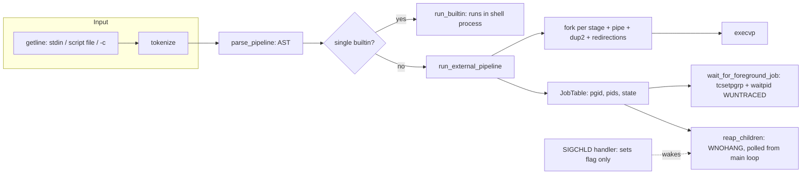

# mini-shell-c

A small interactive Unix shell in C17 — tokenizer, hand-written parser/AST, fork/exec
pipelines, I/O redirection, and real job control (`&`, `jobs`, `fg`, `bg`, `Ctrl-C`/`Ctrl-Z`)
built on process groups and `tcsetpgrp`, not on any shell library.

## Problem

Writing a shell forces you to actually use the primitives everyone reads about but
rarely touches directly: `fork`/`execvp`, pipes, process groups, the controlling
terminal, and async-signal-safe signal handling. The goal here was to build a shell
that is honest about what it does and doesn't support, rather than a toy that silently
diverges from bash and calls it a feature.

## Features

- Tokenizer: single/double quotes, backslash escapes, comments (`#`), operators
  `| < > >> 2> &`.
- Recursive-descent-style parser that builds an AST (`Pipeline` → `Command[]`) and
  **never executes anything while parsing** — `parse_pipeline` only validates syntax.
- Multi-stage pipelines (`a | b | c | ...`) via `fork` + `pipe` + `dup2`, with every
  unused fd closed in every child.
- Redirection per pipeline stage: `<`, `>` (truncate), `>>` (append), `2>` (stderr).
- Background jobs (`&`), `jobs`, `fg [%id]`, `bg [%id]` builtins.
- Real job control: each pipeline gets its own process group; the shell hands the
  controlling terminal to the foreground job's process group via `tcsetpgrp` and takes
  it back when the job exits or stops.
- `SIGINT`/`SIGTSTP` are ignored *by the shell itself* (so Ctrl-C at the prompt doesn't
  kill the shell) and reset to `SIG_DFL` in children right after `fork`, before `exec`.
- `SIGCHLD` handled by an async-signal-safe handler that only sets a flag; all real
  bookkeeping (`waitpid`, job-table updates, "Done"/"Stopped" notifications) happens in
  the main loop, never inside the handler.
- `$?` — the only expansion this shell supports: a standalone `$?` token is replaced
  with the previous command's exit status before exec.
- Builtins `cd`, `pwd`, `exit [n]` run in the shell's own process (never forked).

## Architecture



## Module-by-module walkthrough

- **`tokenizer.c`** (`include/tokenizer.h`): character-level scanner. Single quotes are
  fully literal; double quotes only let `\` escape `\`, `"`; outside quotes `\` escapes
  the next character. `2>` is special-cased only when `2` stands alone (so `file2>out`
  tokenizes as the word `file2` is *not* produced — see the "glued redirect" unit test
  for the exact boundary).
- **`parser.c`** (`include/parser.h`): turns a flat `TokenList` into a `Pipeline` of
  `Command`s. Grammar (documented here, not just in comments):
  ```
  job         := pipeline [ '&' ]
  pipeline    := command ( '|' command )*
  command     := word+ redirection*
  redirection := '<' word | '>' word | '>>' word | '2>' word
  ```
  No `;`, `&&`, `||`, subshells, globbing, or variable expansion other than `$?`. This
  is intentionally much smaller than POSIX shell grammar — see Limitations.
- **`jobs.c`** (`include/jobs.h`): a fixed-size job table (`MAX_JOBS = 64`). Job ids are
  the lowest currently-unused integer (mirrors bash's low-number reuse, not a monotonic
  counter) so the first backgrounded job in a session is `[1]` even if foreground
  commands ran earlier. `jobtable_record_status` is the single place that interprets a
  `waitpid` status (`WIFEXITED`/`WIFSIGNALED`/`WIFSTOPPED`/`WIFCONTINUED`) and updates
  per-pid bookkeeping; `jobtable_refresh_state` aggregates per-pid state into one
  `JobState` for the whole pipeline.
- **`signals.c`** (`include/signals.h`): installs `SIG_IGN` for `SIGINT`/`SIGTSTP`/
  `SIGTTOU`/`SIGTTIN`/`SIGQUIT` in the shell, and a `SIGCHLD` handler that does nothing
  but `g_sigchld_received = 1` (the only operation guaranteed async-signal-safe without
  extra care). `child_restore_default_signals()` undoes all of this in the child right
  after `fork`.
- **`executor.c`** (`include/executor.h`): the core of job control.
  `run_external_pipeline` creates `n-1` pipes for `n` stages, forks each stage, wires up
  `dup2` for the pipe ends plus any explicit redirection, sets the process group (first
  child becomes the group leader via `setpgid(0,0)`; later children join via
  `setpgid(0, pgid)`, with the parent redundantly calling `setpgid(pid, pgid)` too — the
  standard belt-and-suspenders fix for the fork/setpgid race). `wait_for_foreground_job`
  hands the terminal to the job's pgid, then loops on `waitpid(-1, &status, WUNTRACED)`
  — note `-1`, not the specific pgid, so it also opportunistically reaps unrelated
  background jobs that happen to change state while we're blocked, printing their
  notifications immediately instead of waiting for the next prompt.
- **`builtins.c`** (`include/builtins.h`): `cd`/`pwd`/`exit` plus `jobs`/`fg`/`bg`, which
  call back into `executor.c`'s `wait_for_foreground_job` for `fg` so stopped/foreground
  semantics stay in one place.
- **`main.c`**: the REPL / script runner / `-c` single-command mode. Sets
  `setvbuf(stdout, NULL, _IOLBF, BUFSIZ)` unconditionally (see Design decisions below).

## Data flow

1. `main.c` reads one line (interactive prompt, piped stdin, a script file, or `-c`).
2. `tokenize()` → `TokenList`. Syntax errors here (unterminated quote, trailing
   backslash) abort the line with `$?` set to 2.
3. `parse_pipeline()` → `Pipeline` AST. Syntax errors (leading/trailing `|`, `&` not
   last, redirection with no filename) also abort with `$?` set to 2. **Nothing is
   executed during tokenizing or parsing** — this was a hard design constraint, checked
   by code review: every `fork`/`exec`/`open` call lives in `executor.c`.
4. `substitute_last_status()` walks the AST replacing any argv entry that is *exactly*
   `$?`.
5. `execute_pipeline()` either runs a builtin in-process or forks the pipeline.
6. `reap_children()` runs after every line (and would run from a `SIGCHLD`-triggered
   wakeup in a `select`/`poll`-based main loop; here the main loop is synchronous, so it
   polls once per line plus once per `getline` return, which is frequent enough that
   finished background jobs get reported promptly in practice).

## Design decisions and trade-offs

- **No variable expansion except `$?`.** Implementing real word-splitting-after-
  expansion, globbing, and `$VAR`/`${VAR}`/command substitution correctly (including
  how they interact with quoting) is a significant chunk of what makes bash's grammar
  hard. I scoped this down explicitly rather than half-implementing it. `$?` was kept
  because exit-status plumbing was already required for `exit`/scripting and is useful
  on its own.
- **One pipeline per line; no `;`, `&&`, `||`, subshells.** These require a real
  recursive grammar (lists of pipelines with control operators) and job-control
  interactions (what does `&&` mean after a backgrounded command?) that would roughly
  double the parser/executor surface. Documented as a hard limitation, not silently
  dropped.
- **`waitpid(-1, ...)` instead of per-job waiting.** An earlier version waited only on
  the foreground job's own pids. That's wrong: if a background job changes state while
  the shell is blocked waiting on the foreground job, a per-job wait would never see it
  until the *next* blocking wait, delaying "Done"/"Stopped" notifications arbitrarily.
  Waiting on `-1` and dispatching by owning job (via `jobtable_record_status`) fixes
  this and is also exactly what `bash`/`dash` do internally.
- **Job ids reuse the lowest free slot instead of a monotonic counter.** The first
  implementation incremented a counter for *every* pipeline, foreground or background.
  That meant a user who ran three foreground commands before their first `&` would see
  `[4]` as the first job id — technically correct but surprising and not what bash does.
  Switched to "lowest id not currently in use," matching observed bash behavior (see
  `jobs.c:lowest_free_job_id`).
  - **Why not a monotonic counter with higher `MAX_JOBS`?** Doesn't fix the UX issue;
    it's about *which small numbers are visible*, not a capacity problem.
- **`setvbuf(stdout, _IOLBF)` unconditionally, even when stdout isn't a tty.** glibc/
  libc default to fully-buffered stdout when it's not a tty (e.g. piped in tests). That
  meant builtin output (`pwd`, `jobs`, job-done notices) stayed in the shell's own libc
  buffer until the whole process exited, while external children (their own separate
  libc buffers) flushed at their own exit — so merged stdout/stderr came out in the
  wrong order relative to when commands actually ran. This was caught by hand while
  smoke-testing piped/non-interactive mode, not by the automated tests (the pytest
  suite happened not to interleave builtin and external output within one assertion).
  Fixed by forcing line-buffering always, plus an explicit `fflush(stdout)` right before
  every `fork()` so a child never inherits a duplicate of a not-yet-flushed parent
  buffer.
- **`WIFCONTINUED` handling.** The first job-table implementation classified *any*
  non-`WIFSTOPPED` status as "finished" (`j->finished[k] = 1`). That's correct for
  `WIFEXITED`/`WIFSIGNALED` but wrong for `WIFCONTINUED` (sent after `bg`/`fg` resumes a
  stopped job with `SIGCONT`) — it caused a spurious "Done" notification to print
  immediately after `bg`, for a job that was actually still running. Fixed by handling
  all four `WIF*` cases explicitly in `jobtable_record_status` (see `jobs.c`). Caught by
  an interactive pty-based smoke test, then turned into the
  `test_sigtstp_stops_job_then_bg_then_fg` regression test.
- **Builtins never run forked, and never in a pipeline.** `cd`/`exit` only make sense
  in the shell's own process (a forked `cd` would be a no-op for the parent). Running a
  builtin as one stage of a pipeline (e.g. `jobs | wc -l`) is explicitly rejected —
  documented as a limitation rather than silently forking a builtin, which would behave
  differently from running it standalone.

## Complexity analysis

- Tokenizing: `O(n)` in input length, one pass, bounded per-word buffer
  (`MAX_WORD_LEN = 65536`).
- Parsing: `O(t)` in token count, single pass, no backtracking.
- Pipeline execution: `O(k)` forks and `O(k-1)` pipes for `k` stages; each child closes
  `O(k)` fds it doesn't need.
- Job table lookups (`jobtable_find_by_id`, `lowest_free_job_id`, etc.): `O(MAX_JOBS)`
  linear scan over a fixed-size (64-entry) array — simplest-correct choice given the
  table is small and job-control operations are human-interactive-speed, not hot-path.

## Build / run / test

### macOS
```sh
brew install cmake ninja   # if not already present
./scripts/build_and_test.sh
./build/minishell
```

### Linux
```sh
sudo apt-get install -y cmake ninja-build python3-venv
./scripts/build_and_test.sh
./build/minishell
```

`scripts/build_and_test.sh` configures and builds the Debug, ASan, and UBSan CMake
variants, runs `ctest` for each, then runs the Python integration suite
(`tests/python`) against the Debug binary. If `cmake` isn't on `PATH` it bootstraps one
into a project-local `.venv` via `pip install cmake ninja` (no `sudo`, no global
install) — see **Limitations** for why this was needed on the machine this was built
on.

Manual equivalent:
```sh
cmake -S . -B build -DCMAKE_BUILD_TYPE=Debug
cmake --build build
ctest --test-dir build --output-on-failure
```

## Demo walkthrough (real output, captured on this machine)

```
$ printf 'echo hello world\npwd\nls | grep -c c\necho a > out.txt\ncat out.txt\necho b >> out.txt\ncat out.txt\nexit 7\n' | ./build/minishell
hello world
/private/tmp/mshelltest
0
a
a
b
$ echo "exit code: $?"
exit code: 7
```

Interactive job control (captured via a pty-driving script, not hand-typed):
```
minishell$ sleep 30
sleep 30
^C
minishell$ echo still_alive
still_alive
minishell$ sleep 30
sleep 30
^Z
[1]+  Stopped                 sleep 30
minishell$ bg
[1]+ sleep 30 &
minishell$ jobs
[1]+  Running                 sleep 30
minishell$ fg
sleep 30
^C
minishell$ exit 3
```

## Testing strategy

- **C unit tests** (`tests/c/test_tokenizer.c`, `tests/c/test_parser.c`, run via CTest):
  pure functions, no process spawning — quoting edge cases, operator boundaries,
  malformed-syntax error paths, all without forking a single process.
- **Python integration tests** (`tests/python/`, pytest):
  - `test_shell_basic.py` drives the shell non-interactively over a pipe
    (`subprocess.run`) in a fresh `tmp_path` per test: builtins, pipelines, truncate vs.
    append redirection, stderr redirection, quoting, malformed syntax, exit codes,
    "command not found" (127), no zombies after a pipeline.
  - `test_job_control.py` drives the shell over a real pty (`pexpect`), because
    `tcsetpgrp` and terminal-generated `SIGINT`/`SIGTSTP` are meaningless without a
    controlling terminal: background jobs, `jobs`, Ctrl-C/Ctrl-Z, `bg`/`fg`, exit status
    after a signal (130 = 128+SIGINT), no zombies after a background job finishes.
- All of the above run three times by `build_and_test.sh`: against the plain Debug
  binary, the ASan binary, and the UBSan binary.

## Limitations (vs. bash) — stated explicitly, not claimed as POSIX-compliant

- No `;`, `&&`, `||`, subshells `()`, command grouping `{}`.
- No variable expansion/export, no globbing, no command substitution. `$?` is the one
  hardcoded exception.
- No heredocs (`<<`).
- Builtins cannot be backgrounded or used as one stage of a pipeline.
- A background job's completion is only reported when the shell happens to poll (each
  `getline` return) — there's no `select`/`poll`-driven immediate reaping, so "Done" can
  lag very slightly behind the next prompt if nothing else is happening (acceptable for
  an interactive shell; see Future work).
- Job table is a fixed 64 entries (`MAX_JOBS`); the 65th concurrent job fails to
  register (reported, not silently dropped — `jobtable_add` returns `-1`).
- Tested and built on macOS (Apple Silicon); Linux is covered by GitHub Actions CI
  (`ubuntu-latest`) but not separately verified on a physical Linux machine as part of
  this build.
- **Homebrew on this machine had a broken prefix** (`/opt/homebrew` owned by a different
  local user, not writable and not `chown`-able without `sudo`, which these build rules
  forbid). `cmake`/`ninja` were bootstrapped via `pip install cmake ninja` (PyPI ships
  prebuilt binary wheels for both) into a project-local `.venv` instead. This is
  transparent to normal use — `scripts/build_and_test.sh` detects a missing `cmake` and
  does this automatically — but is called out here since the instructions assumed a
  working Homebrew.

## Future work

- A real control-operator grammar (`;`, `&&`, `||`) as a list of pipelines with explicit
  short-circuit semantics.
- `$VAR` / `${VAR}` expansion and `export`, with word-splitting rules documented before
  implementation (this is where most "it looks like bash but isn't" bugs would live).
- A `select`/`poll`-driven main loop so background job completion is reported the
  instant `SIGCHLD` fires, not just on the next `getline` return.

## What I learned

The fork/setpgid race (whether the parent or the child sets the process group first)
is exactly as fiddly as every shell-writing tutorial warns — doing it from both sides
is cheap insurance. The more interesting bug in practice was `WIFCONTINUED`: it's easy
to write `if (WIFSTOPPED) ... else treat-as-done`, and that's *correct* until the very
first time something is stopped and resumed, at which point it corrupts the job state
table silently (printed a wrong "Done" line) instead of crashing — a reminder that
`waitpid`'s status word has more than two states and every caller needs to handle all
of them explicitly, not with an `else`.
